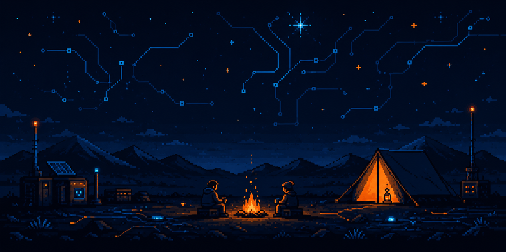

  

# Gustavo Harnisch

### Computer Science 
**ICPC Regional Competitor · 9th in Chile, 2023 · Team Leadership**

Building software, coaching programming teams, and creating shared learning resources.

  
  
  
  

---

### About

Computer Science and Engineering student at Universidad Católica del Maule
(UCM), focused on Backend Development, Data Engineering, and algorithms.
Interested in combining technical expertise with management to improve
processes, support teams, and make informed decisions.

> 🔎 Open to **internships, trainee programs, and entry-level roles**
> in Data or Backend Engineering — Chile or remote.

---

### Leadership & Competitive Programming

- **ICPC Regional Chile competitor, 2023–2025:** best result of **9th nationally in 2023**.
- **Head Coach and Instructor, UCM Competitive Programming Club:** plan training, teach algorithms, and support competition teams.
- **Organized three internal university contests** following the ICPC format to strengthen students' problem-solving skills.
- **Maintain [CICP-2026](https://github.com/Gustavo-Harnisch/CICP-2026):** structured study resources for competition preparation.

---

### Technical Focus

| Area | Technologies & Concepts |
| :--- | :--- |
| **Backend & Data** | Node.js · JavaScript · SQL · Oracle · REST APIs · Data modeling |
| **Algorithms** | C++ · Dynamic programming · Graphs · Geometry · Data structures |
| **Tools & Systems** | Git · GitHub · Linux · Rust |

---

### Featured Projects

#### [UCM Competitive Programming Handbook](https://github.com/Gustavo-Harnisch/Handbook-UCM)

Created and maintain an open-source learning resource for the UCM community,
building on the UTFSM handbook with attribution to its contributors.

- Structured learning materials and documented C++ implementations.
- Contribution guidelines, reusable templates, and code validation.
- Shared sources for web and PDF publication.

#### [CRUD Oracle](https://github.com/Gustavo-Harnisch/CRUD-oracle)

Backend application connecting a **Node.js REST API** to **Oracle XE 21c**,
with CRUD operations, input validation, error handling, and relational data modeling.

---

### Support my work

